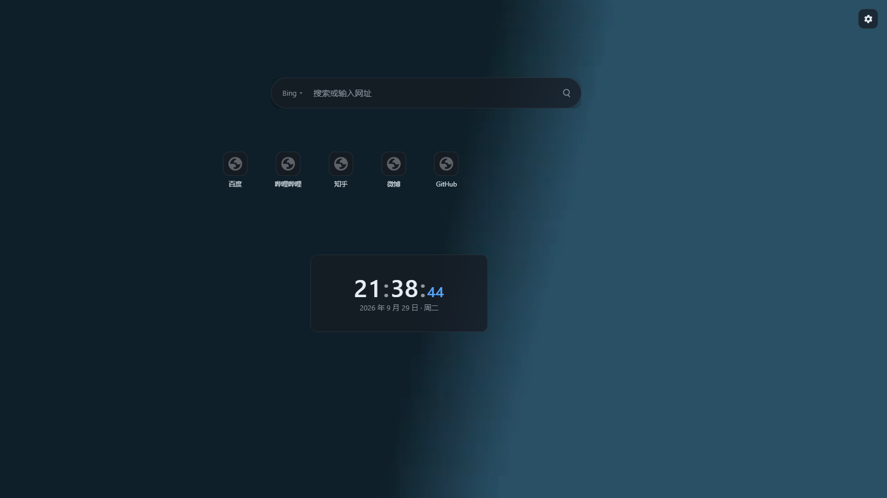

# KaijTab

自由画布式新标签页扩展：**任意拖放布局**、**导入 Wallpaper Engine 动态壁纸**、**模块按需加载**、零服务端。

- 技术：Manifest V3 + Vite + Preact + TypeScript
- 数据：本地存储 + 可选的浏览器账号同步（壁纸与模块私有数据永不上云）
- 定位：自用，不上架



## 快速开始

```bash
pnpm install
pnpm build          # 产物在 dist/
```

加载到浏览器：

1. 打开 `chrome://extensions`（Edge 为 `edge://extensions`）
2. 打开右上角"开发者模式"
3. 点"加载已解压的扩展程序"，选择本项目的 `dist` 目录
4. 新开一个标签页即可看到 KaijTab

> 修改代码后重新 `pnpm build`，回到扩展页点一次"刷新"按钮即可生效（开发时可用 `pnpm dev` 进入 watch 构建）。

## 功能

| 能力 | 说明 |
|---|---|
| 自由画布 | 任意拖放/八向缩放/允许重叠/点击置顶；拖拽时自动吸附（Alt 临时关闭）；方向键微调；撤销/重做（50 步）；右键菜单置顶/置底/复制/锁定/删除/设置 |
| 外观 | **玻璃质感**三档切换：无 / 磨砂玻璃 / 液态玻璃（全局默认 + 单元件覆盖）；**元件内容随尺寸自适应**（容器查询单位，时钟文字、搜索框、图标全部按比例缩放） |
| 动态壁纸 | **视频**（mp4/webm/mov/mkv/avi… 能不能解码交给浏览器判断）、**图片**（png/jpg/webp/**gif**/**svg**/avif/bmp 等，GIF/APNG 天然就是动态壁纸）、**网页壁纸**（Wallpaper Engine 的 web/application 工程：整目录导入 → OPFS → 沙箱 iframe + Service Worker 虚拟文件服务，相对路径的 CSS/JS/纹理/fetch 全部可用）；支持从壁纸引擎工坊目录批量导入；拷贝进 OPFS 后与原文件解耦；页面隐藏自动暂停；支持导出与占用统计 |
| 主题 | **深色 / 浅色 / 跟随系统** 三档（默认跟随系统）；浅色模式连玻璃材质、默认背景渐变、输入框、图标底色一起适配 |
| 核心底座 | 搜索框（Bing/百度/Google 一键切换，输入网址直接跳转）、快捷方式（**网站图标自动获取**，失败回退首字母，可手填图标地址） |
| 导航图标摆放 | 右键网站导航 →「排列图标」：**每个网站图标都能单独拖到任意位置**，自动吸附对齐线、8px 网格兜底、Alt 关闭吸附；位置按比例保存，元件缩放时整组图标跟着缩放；支持「恢复自动排列」一键回到网格 |
| 内置模块 | **时钟**（秒/日期/12 小时制）、**便签**（自动保存）、**待办清单**（勾选/进度/清除已完成）、**倒计时·纪念日**（每年重复、倒数/累计）、**天气**（Open-Meteo 免费源，城市搜索 + 今日高低温 + 体感/湿度/风）、**浏览器书签**（书签栏/其他书签，逐层进入文件夹） |
| 模块中心 | 默认极简，功能以模块形式按需启用；模块代码只在画布上存在实例时才加载（独立 chunk，含 CSS） |
| AI 推荐 | 接入**你自己的 OpenAI 兼容接口**（OpenAI / DeepSeek / Moonshot / 本地 Ollama…），按近期浏览统计、书签与快捷方式推荐此刻想打开的链接；**每次打开新标签页都重新生成**；默认请求**低思考档位**（`reasoning_effort` / `enable_thinking` / `thinking` 三套字段，接口不支持时自动降级并记住）；输出限长 600 tokens、提示词要求直接给 JSON；本地聚合脱敏（**查询串全部剥离**）、可预览将发送的数据、API Key 只存本地不参与同步、接口域名按需授权 |
| 账号同步 | 可选开启；布局/快捷方式/设置走 `chrome.storage.sync` 分块同步；超配额自动关闭并提示；模块私有数据（便签正文、待办条目、天气缓存）只存本地 |

## 触屏与窄窗口

- **触屏设备**（触控笔记本、带笔的设备）：主要按钮与菜单项 ≥44px；编辑入口（齿轮）常驻显示（不再依赖鼠标悬停）；**长按元件 = 右键菜单**；拖拽不会被页面滚动打断
- **窄窗口**：把浏览器窗口拖窄到 ≤720px 时，面板自动变全屏抽屉、工具栏换行，布局仍然可用
- 窗口尺寸变化时元件按归一化坐标自动跟随；首次播种也按实际视口计算（不会出现超出窗口的默认尺寸）

## 测试

```bash
pnpm test           # 单元测试（坐标/吸附/撤销栈/迁移/同步分块）
pnpm build && pnpm exec playwright test   # E2E：加载真实扩展跑全链路
node scripts/screenshots.mjs              # 生成 docs/screenshots/
pnpm new:module <id>                      # 生成新模块骨架
```

当前覆盖：**105 单测 + 52 E2E**（含触屏与窄窗口用例）；冷启动到可交互约 **50–90ms**，核心 chunk gzip **≈33KB**（各模块 0.6–4.4KB，按需加载；网页壁纸虚拟文件服务 0.8KB）。

## 项目结构

```
src/
├─ background/          service worker（只做安装初始化，常驻逻辑为零）
├─ newtab/
│  ├─ canvas/           布局引擎：geometry / snapping / history（纯函数，有单测）+ 组件
│  ├─ core/             核心底座：搜索 / 快捷方式 / 壁纸（OPFS、导入、播放、面板）
│  ├─ module-host/      模块宿主：注册表 / 按需加载 / 错误边界 / runtime / 模块中心 / 实例设置
│  ├─ editor/           编辑态工具栏
│  ├─ ui/               全局提示
│  └─ styles/           主题令牌与样式
├─ modules/             模块目录（每个模块独立 chunk）
│  ├─ clock/            时钟（尺寸自适应 + 主题令牌的参考实现）
│  ├─ note/             便签（runtime.data 私有数据 + 防抖自动保存）
│  ├─ todo/             待办清单
│  ├─ countdown/        倒计时 / 纪念日（纯逻辑带单测）
│  ├─ weather/          天气（网络请求 + 缓存 + 失败降级，纯逻辑带单测）
│  ├─ bookmarks/        浏览器书签（chrome.bookmarks + 逐层进入）
│  └─ ai-recommend/     AI 推荐（自接 OpenAI 兼容接口，本地聚合脱敏 + 档缓存）
└─ shared/              类型 / 存储 / 迁移 / 工具 / 共享组件
docs/
├─ superpowers/specs/   设计文档
├─ superpowers/plans/   实施计划
├─ manual-checklist.md  人工验收清单
└─ screenshots/
```

## 模块开发

见 `src/modules/README.md`。一句话版本：复制 `src/modules/clock/`，或 `pnpm new:module <id>` 生成骨架，改 `meta.ts` + `index.tsx` 即可。

硬性规则：模块禁止直接访问 `chrome.*`（走 `runtime`）、禁止写死颜色（用 CSS 变量）、必须声明尺寸约束、定时器要响应 `runtime.visibility`。

## 已知限制

- 壁纸三类支持情况：视频 ✅、图片 ✅、**网页工程**（WE 的 web/application）✅（有下述限制）、场景类 `scene.pkg` ❌（需要重写 WE 的场景渲染引擎，不做）
- 网页壁纸：导入时会自动把内联 `<script>` 外置成文件（MV3 的 CSP 不允许内联脚本）；依赖 `eval` / `new Function`、或 WE 专有 JS 接口（`wallpaperPropertyListener`）的工程可能表现不完整
- 视频/图片格式放宽后，能否播放由浏览器解码能力决定；不支持时导入即报错并说明原因
- 不内置转码：编码不受支持的视频不会自动转换
- 壁纸不上云：换设备需要重新导入（布局会同步，壁纸缺失时自动回落默认背景）
- 跨设备同步依赖浏览器的账号同步通道，超出配额（100KB）会自动关闭同步
- 网站图标按「站点 `/favicon.ico` → `apple-touch-icon.png` → `favicon.png` → 首字母」取；若站点图标走了非标准路径（只写在 HTML `<link rel="icon">` 里的），请在该快捷方式的编辑弹窗里手动填图标地址
- 天气数据源为 Open-Meteo（免费、无需 key），无网络时显示上次成功获取的数据并给出错误提示
- 书签模块需要 `bookmarks` 权限（首次加载新版本扩展时浏览器会提示）
- AI 推荐：需要 `history` 权限；接口域名按需授权（保存配置时弹一次）。只把本地聚合摘要发给你的接口，不经过任何中间服务器；API Key 存本地专用切片，永不参与账号同步。模型返回质量取决于你选的模型
- 未做：多选对齐、分组管理、i18n、Firefox
